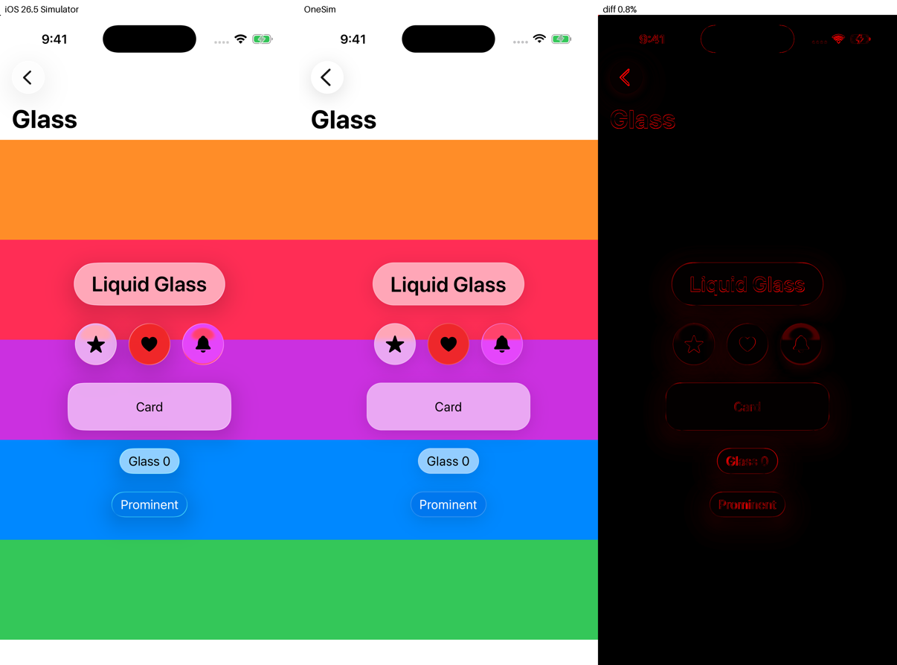

<h1 align="center">OneSim</h1>

<p align="center">
  <strong>Run, inspect, and automate mobile UI</strong><br>
  One runtime for SwiftUI, Expo / React Native, and Jetpack Compose.<br>
  Preview SwiftUI in a browser or drive apps headlessly from the CLI and session API.
</p>

<p align="center">
  <a href="https://github.com/MitchellSPeterson/SimCore/actions/workflows/ci.yml"></a>
  <a href="LICENSE"></a>
</p>

<p align="center">
  <a href="#quick-start">Quick start</a> ·
  <a href="docs/README.md">Documentation</a> ·
  <a href="docs/compatibility/README.md">Compatibility</a> ·
  <a href="docs/roadmap.md">Roadmap</a> ·
  <a href="CONTRIBUTING.md">Contributing</a>
</p>

<p align="center">
  <a href="docs/ios-comparison.md#comparison-gallery"><picture>
    <source media="(prefers-color-scheme: dark)" srcset="docs/ios-comparison/cmp-glass-dark.png">
    
  </picture></a><br>
  <sub>Liquid Glass in the iOS 26.5 Simulator and OneSim, followed by the pixel diff.</sub>
</p>

## Quick start

On macOS with Rust stable and the Swift toolchain from Xcode or Command Line Tools, clone the repository and run the counter.

```sh
git clone https://github.com/MitchellSPeterson/SimCore.git OneSim
cd OneSim
cargo run -p onesim-cli -- run \
  examples/swiftui-counter \
  --root-view CounterView \
  --click Increment \
  --screenshot counter.png --inspect
```

OneSim compiles the SwiftUI example, taps **Increment**, and saves `counter.png`. The printed UI tree contains `Count: 1`. This runs without an iOS Simulator, Chromium, or a GPU.

For Expo, Compose, browser builds, and CLI input options, see the [getting-started guide](docs/getting-started.md).

## Framework support

| Framework | Target | What you can run |
| --- | --- | --- |
| [SwiftUI](docs/compatibility/swiftui/README.md) | iOS 27.2 and 26.5, WebAssembly | Navigation, tabs, forms, sheets, Dynamic Type, SF Symbols, and Liquid Glass. |
| [Expo / React Native](docs/compatibility/expo/README.md) | iOS preview | Metro bundles with Fabric, Fast Refresh, Expo Router, and simulated device modules. Android support is planned. |
| [Jetpack Compose](docs/compatibility/compose/README.md) | Android 17 preview | The AndroidX Compose runtime with Material 3 controls and layouts on a Pixel 10a profile. |

OneSim runs each framework’s supported UI code in a guest process and renders it on a shared Rust host. SwiftUI can also run in the browser, where the app and renderer compile to a single WebAssembly module. [Architecture](docs/architecture.md) · [Browser guide](docs/web.md)

## Visual fidelity

OneSim tests its renderer against screenshots from the iOS Simulator and Android emulator. The comparison scripts check each state on the two supported iOS versions and on Android 17. See the [iOS results and known gaps](docs/ios-comparison.md) and the [Android reference fixtures](tests/fixtures/compose-android/README.md).

## Documentation

- [Run an app and capture a screenshot](docs/getting-started.md)
- [Build a SwiftUI app for the browser](docs/web.md)
- [Automate sessions and UI input](docs/api.md)
- [See how the renderer and guests fit together](docs/architecture.md)
- [Find every guide and reference](docs/README.md)

## Contributing

Start with the [contributor guide](CONTRIBUTING.md). For a missing API, check the [coverage tables](docs/compatibility/README.md) and open an [API request](https://github.com/MitchellSPeterson/SimCore/issues/new?template=api-request.yml).

## License

OneSim is [MIT-licensed](LICENSE). The bundled fonts and icons retain their [own licenses](docs/architecture.md#fonts-and-symbols).
