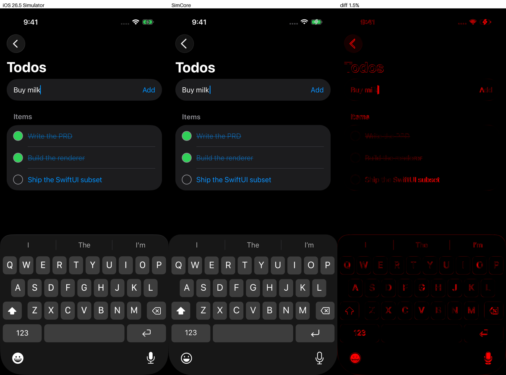
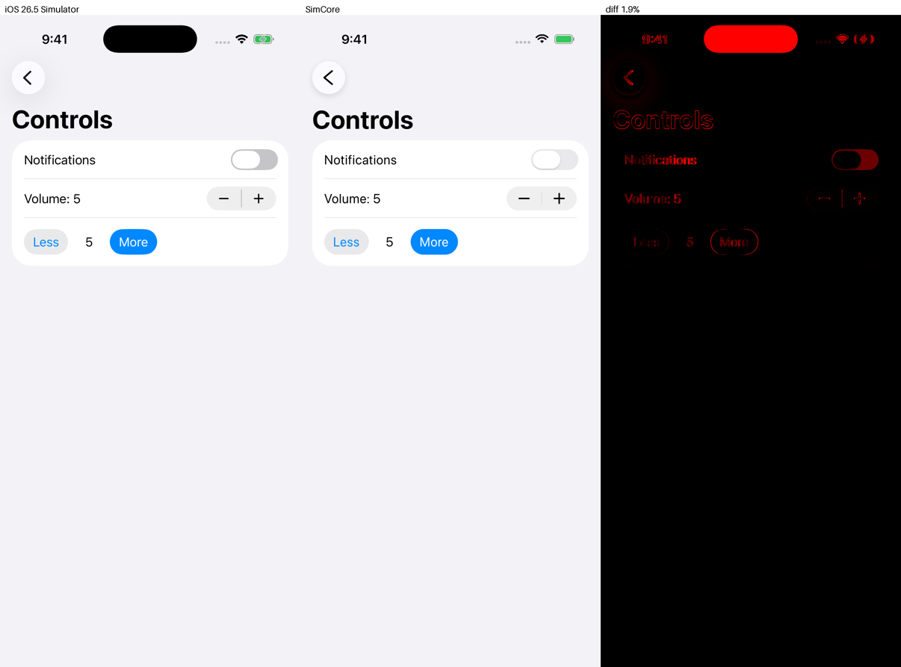
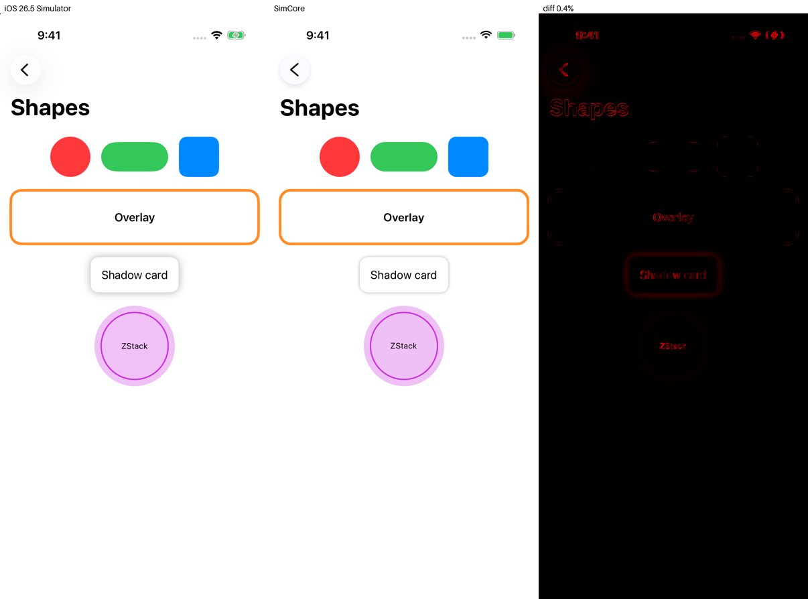
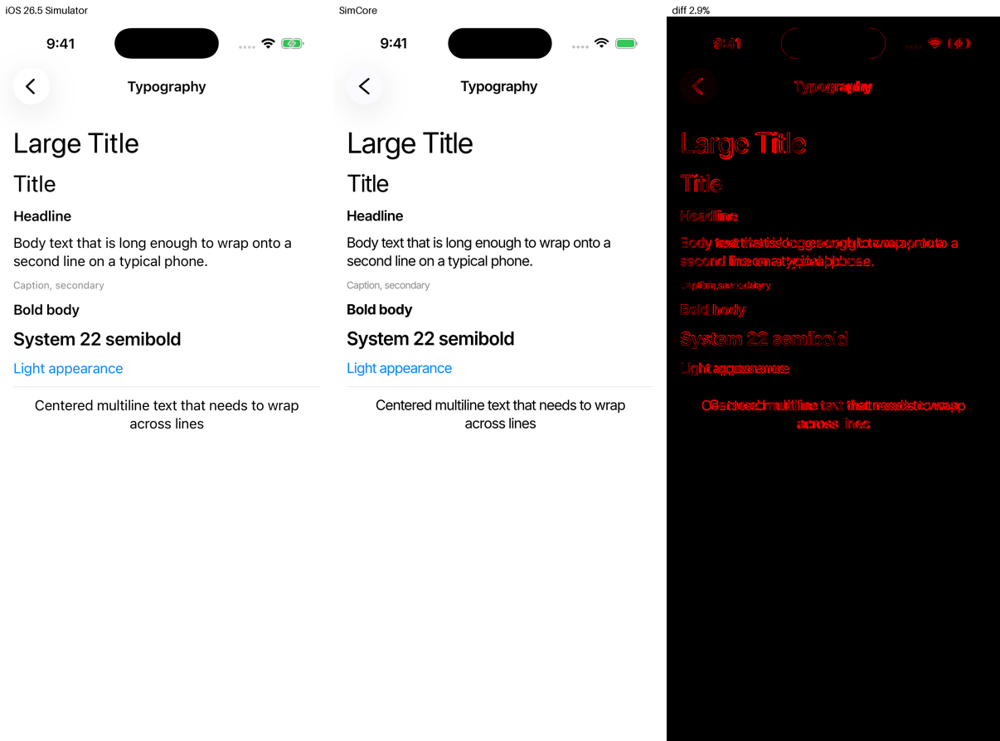

# SimCore vs iOS Simulator

Same unmodified source (`examples/swiftui-showcase/Showcase.swift`) rendered by:
- **iOS 26.5 Simulator**, iPhone 17 Pro (Apple's SwiftUI), shots in `tests/fixtures/showcase-ios/`
- **SimCore** (SimCore's SwiftUI module + Rust renderer, headless), 402×874 @3x

**Pass rule:** every state must be < 2% (see CONTRIBUTING.md). CI enforces it.

Reproduce: `scripts/compare-ios.sh` (needs Python + Pillow). Re-capture iOS references: `scripts/build-ios-sim.sh`, then follow `tests/fixtures/showcase-ios/README.md`.

| state | pixels >10% off | mean abs diff | notes |
|---|---:|---:|---|
| controls-changed | 0.7% | 0.7 | text antialiasing, status bar icons |
| controls | 0.6% | 0.7 | text antialiasing, status bar icons |
| home-dark | 0.7% | 0.9 | text antialiasing, status bar icons |
| home | 0.7% | 1.0 | text antialiasing, status bar icons |
| keyboard-dark | 1.9% | 1.8 | Liquid Glass back button (dark) |
| keyboard-shift | 1.4% | 1.6 | text antialiasing, status bar icons |
| shapes | 0.4% | 0.6 | text antialiasing, status bar icons |
| symbols-dark | 1.2% | 1.1 | Liquid Glass back button (dark) |
| symbols | 0.8% | 1.0 | text antialiasing, status bar icons |
| todos-toggled | 0.6% | 0.5 | text antialiasing, status bar icons |
| todos-typed | 1.4% | 1.6 | text antialiasing, status bar icons |
| todos | 0.6% | 0.6 | text antialiasing, status bar icons |
| typography | 1.5% | 2.1 | glyph-width drift (no SF `opsz` axis) |

Every state still differs by the battery charging bolt, which SimCore doesn't draw.

## Fixed by this comparison

- **Spacers in stacks are sized last.** Before, `HStack { Text; Spacer }` split the space evenly, so text wrapped at half width.
- **System colors now use the iOS 26 palette.** Red #FF383C, orange #FF8D28, blue #0088FF, purple #CB30E0. Dark variants are sent over the wire (`Color.dark`).
- **SF Symbols** are rasterized from the host's system SF Symbols through AppKit. They are sized like iOS, and Label rows use iOS geometry.
- **Software keyboard.** Light and dark; keys are tappable; shift and auto-capitalization work; content moves up above it. Before this, the keyboard screen's mean pixel difference was 8.3; now it is 1.6.
- **Dynamic Island** is part of the device profile.
- **Shadows are a true Gaussian blur.** iOS uses sigma ≈ `radius` (fitted to the simulator's falloff), not radius/2.

## Known gaps

- The Liquid Glass back button is an approximation, most visible in dark mode.
- Text widths can drift 1–2 px from iOS.
- Corners are circular, not continuous.
- The keyboard's suggestions are static, and it has no 123 or emoji layers.
- Symbols are monochrome only.

## Fallback mode (non-macOS hosts)

When Apple's fonts and symbols are unavailable, or when forced with `SIMCORE_FALLBACK=1`, SimCore uses bundled open assets:
- **Inter 4.1** (SIL OFL 1.1). Letter spacing is fitted per size so widths and wrapping match SF.
- **Phosphor Icons 2.1.1** (MIT). 270 SF Symbol names are mapped onto Phosphor's regular, bold and fill styles, sized to SF's layout boxes. Unmapped names draw a placeholder and report `unsupported_symbol`.

Pass rule in this mode is **< 3.5%**: the 2% budget plus the measured glyph-shape gap. CI runs both modes. Worst states are typography (2.85%), keyboard-dark (2.75%), todos-typed (2.24%) and keyboard-shift (2.23%), all driven by Inter's glyph shapes. All 13 states pass.

