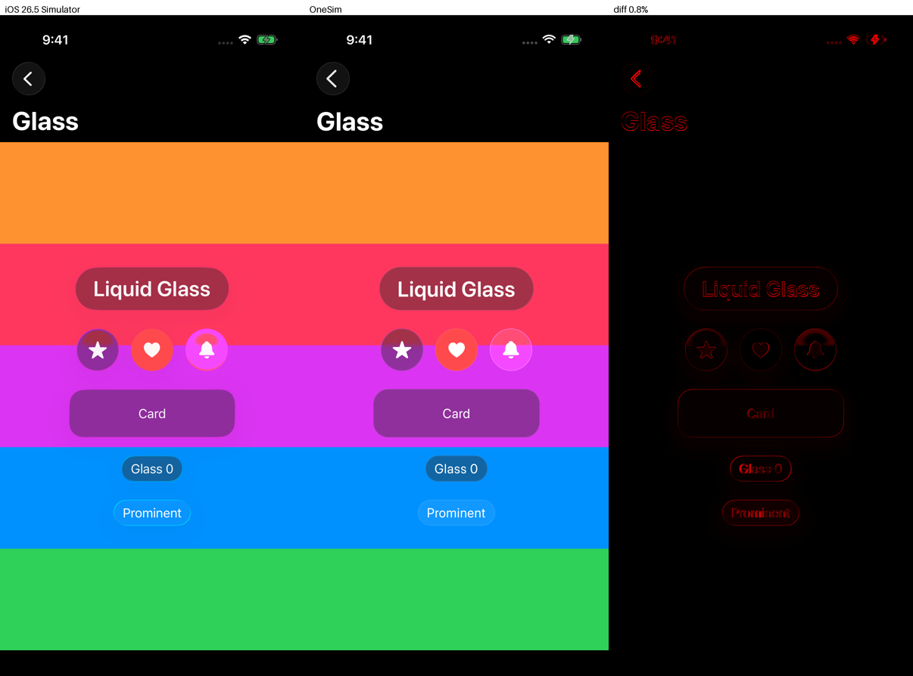
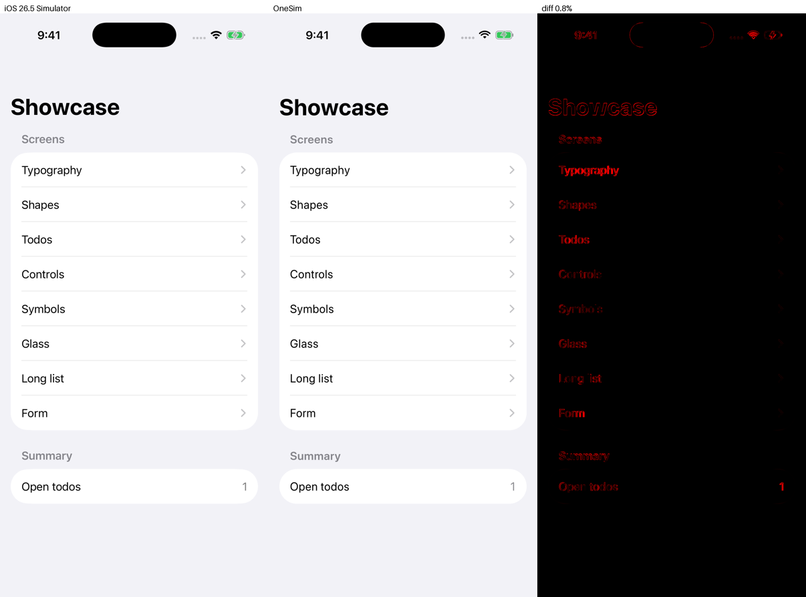
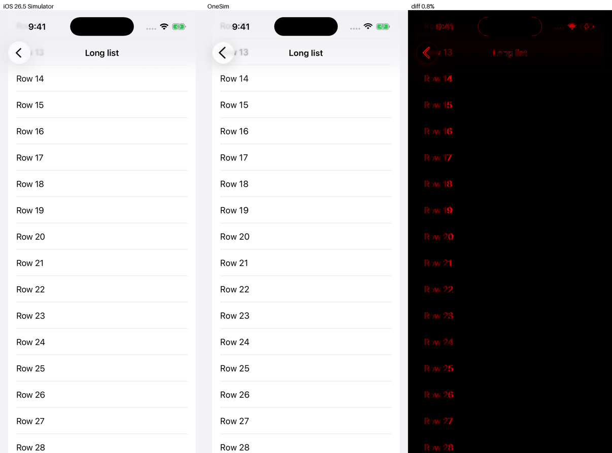
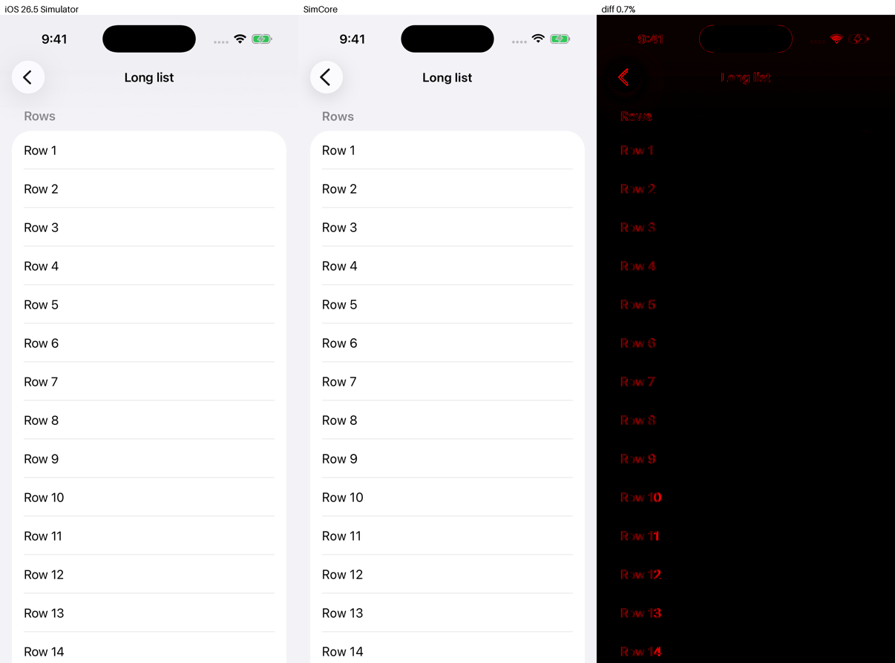
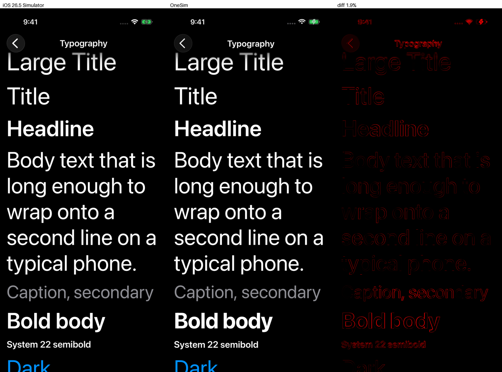
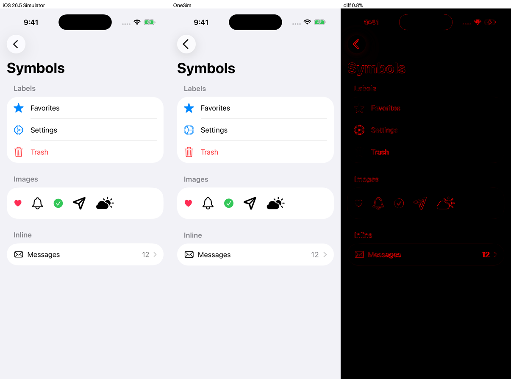
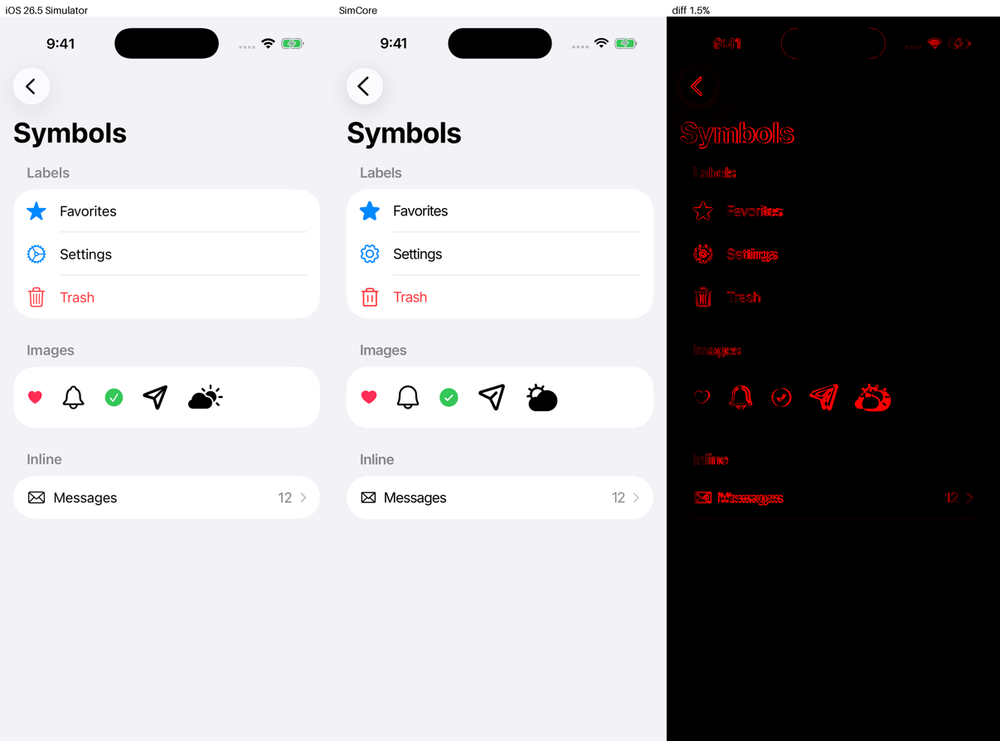

[SimCore](../README.md) / [Documentation](README.md)

# SimCore vs iOS Simulator

SimCore runs the same example sources as the iOS Simulator. The comparison script counts pixels whose difference luminance exceeds 24/255. Each state must be **under 2%** with Apple fonts and symbols, or **under 3.5%** with bundled Inter and Phosphor, subject to the [documented per-state exceptions](../CONTRIBUTING.md#visual-fidelity-rule).

[iOS 27.2 results](#ios-272) · [iOS 26.5 results](#ios-265) · [Comparison gallery](#comparison-gallery) · [Known gaps](#known-gaps)

## Reproduce the comparisons

Install Python 3 with Pillow. To include React Native and Expo Router, run `npm ci` in each of `examples/expo-showcase`, `examples/expo-default`, and `examples/expo-router-stack`.

Run both modes from the repository root. Both commands compare the supported iOS releases. Set `SIMCORE_IOS=27.2` to compare just that release.

```sh
scripts/compare-ios.sh
SIMCORE_FALLBACK=1 scripts/compare-ios.sh
```

To replace a reference capture, follow the instructions for [iOS 27.2](../tests/fixtures/ios27/README.md) or [iOS 26.5](../tests/fixtures/showcase-ios/README.md).

## iOS 27.2

The default profile is iPhone 18 Pro on iOS 27.2 (`--ios 27.2`). The table includes the showcase, tab, and Expo apps, plus iPhone 18 Pro Max, 17e, and Duo device fixtures. These measurements were taken on November 19, 2026, on macOS 27 with Xcode 27.2.

<details>
<summary>Pixel diff by app and state</summary>

| app / state | system fonts | fallback (`SIMCORE_FALLBACK=1`) |
|---|---:|---:|
| showcase / alert-dark | 0.93% | 1.58% |
| showcase / alert | 1.18% | 1.83% |
| showcase / controls-changed | 1.03% | 1.45% |
| showcase / controls | 0.89% | 1.44% |
| showcase / cover-dark | 0.25% | 0.28% |
| showcase / cover | 0.26% | 0.30% |
| showcase / dialog-dark | 1.45% | 2.07% |
| showcase / dialog | 1.53% | 2.11% |
| showcase / form-changed | 0.95% | 1.11% |
| showcase / form-dark | 0.87% | 1.05% |
| showcase / form-menu | 1.07% | 1.28% |
| showcase / form | 0.86% | 1.05% |
| showcase / glass-dark | 0.61% | 0.77% |
| showcase / glass-pressed | 0.78% | 0.90% |
| showcase / glass | 0.77% | 0.92% |
| showcase / home-dark | 0.78% | 1.11% |
| showcase / home | 0.78% | 1.11% |
| showcase / keyboard-dark | 1.74% | 2.40% |
| showcase / keyboard-shift | 1.38% | 2.26% |
| showcase / long-list-collapsed | 0.74% | 1.02% |
| showcase / long-list-scrolled | 0.77% | 1.12% |
| showcase / long-list | 0.68% | 0.97% |
| showcase / shapes | 0.42% | 0.58% |
| showcase / sheet-dark | 0.16% | 0.31% |
| showcase / sheet-medium-dark | 0.93% | 1.42% |
| showcase / sheet-medium | 1.12% | 1.62% |
| showcase / sheet-nested-dark | 1.47% | 1.50% |
| showcase / sheet-nested | 1.58% | 1.61% |
| showcase / sheet | 0.18% | 0.34% |
| showcase / symbols-dark | 0.85% | 1.54% |
| showcase / symbols | 0.81% | 1.50% |
| showcase / todos-toggled | 0.56% | 1.14% |
| showcase / todos-typed | 1.63% | 2.29% |
| showcase / todos | 0.57% | 1.16% |
| showcase / typography-scrolled-dark | 1.90% | 4.82% |
| showcase / typography-scrolled | 1.91% | 4.88% |
| showcase / typography | 1.68% | 2.76% |
| SwiftUI TabView / tabs-home-dark | 0.78% | 1.02% |
| SwiftUI TabView / tabs-home | 0.75% | 0.97% |
| SwiftUI TabView / tabs-pushed | 0.69% | 0.99% |
| SwiftUI TabView / tabs-second | 0.60% | 0.96% |
| SwiftUI TabView / tabs-settings-dark | 0.86% | 1.19% |
| React Native / alert-dark | 0.63% | 0.89% |
| React Native / alert | 0.89% | 1.18% |
| React Native / controls-changed | 0.47% | 0.59% |
| React Native / controls-typed | 1.43% | 1.65% |
| React Native / controls | 0.54% | 0.66% |
| React Native / home-dark | 0.45% | 0.69% |
| React Native / home | 0.45% | 0.69% |
| React Native / image | 0.14% | 0.17% |
| React Native / keyboard-avoiding-dark | 1.25% | 1.35% |
| React Native / keyboard-avoiding | 1.17% | 1.30% |
| React Native / layout | 0.56% | 0.64% |
| React Native / refresh-pulled-dark | 0.81% | 1.45% |
| React Native / refresh-pulled | 0.80% | 1.45% |
| React Native / scroll-scrolled | 0.86% | 1.13% |
| React Native / scroll | 0.77% | 1.02% |
| React Native / text | 2.45% | 4.35% |
| React Native / visuals-dark | 0.78% | 0.89% |
| React Native / visuals | 0.87% | 0.99% |
| Expo Router / tabs-explore-dark | 1.43% | 2.27% |
| Expo Router / tabs-explore-expanded | 1.86% | 3.26% |
| Expo Router / tabs-explore | 1.37% | 2.21% |
| Expo Router / tabs-home-dark | 1.04% | 1.25% |
| Expo Router / tabs-home | 1.35% | 1.56% |
| Expo Router / stack-back | 0.31% | 0.39% |
| Expo Router / stack-detail-dark | 0.56% | 0.63% |
| Expo Router / stack-detail | 0.43% | 0.57% |
| Expo Router / stack-list | 0.31% | 0.39% |
| iphone-17e / home | 0.88% | 1.19% |
| iphone-17e / keyboard-shift | 1.49% | 2.43% |
| iphone-18-pro-max / home | 0.72% | 0.95% |
| iphone-18-pro-max / keyboard-shift | 1.29% | 2.02% |
| iphone-duo / home | 0.60% | 0.80% |
| iphone-duo / keyboard-shift | 1.48% | 2.01% |

</details>

## iOS 26.5

These measurements compare the [SwiftUI showcase](../examples/swiftui-showcase/Showcase.swift) on the iPhone 17 Pro (`--ios 26.5`), at 402 × 874 points and 3× scale.

<details>
<summary>Pixel diff by showcase state</summary>

| state | system fonts | fallback (`SIMCORE_FALLBACK=1`) | notes |
|---|---:|---:|---|
| controls | 0.89% | 1.43% | text antialiasing, status bar icons |
| controls-changed | 1.03% | 1.44% | text antialiasing, status bar icons |
| glass | 0.81% | 0.97% | rim lens crescents on the star/bell, text antialiasing |
| glass-dark | 0.76% | 0.90% | rim lens crescents, text antialiasing |
| alert | 1.07% | 1.73% | glass card blur and capsule text antialiasing |
| alert-dark | 0.94% | 1.59% | same |
| sheet | 0.20% | 0.34% | text antialiasing |
| sheet-dark | 0.18% | 0.32% | text antialiasing |
| sheet-medium | 0.98% | 1.47% | floating glass card; blur and rim of the glass |
| sheet-medium-dark | 0.96% | 1.44% | same |
| sheet-nested | 0.19% | 0.33% | text antialiasing |
| sheet-nested-dark | 0.18% | 0.31% | text antialiasing |
| dialog | 1.20% | 1.82% | popover glass and shadow |
| dialog-dark | 1.27% | 1.87% | same |
| cover | 0.28% | 0.30% | text antialiasing |
| cover-dark | 0.27% | 0.30% | text antialiasing |
| glass-pressed | 0.82% | 0.95% | same as glass; only the label differs |
| home | 0.76% | 1.07% | text antialiasing, status bar icons |
| home-dark | 0.77% | 1.07% | text antialiasing, status bar icons |
| long-list | 0.69% | 0.96% | large title expanded |
| long-list-collapsed | 0.65% | 0.93% | large title collapsed into the inline bar (snap point, 52pt) |
| long-list-scrolled | 0.79% | 1.13% | rows under the bar: progressive veil + blur |
| keyboard-dark | 1.51% | 2.38% | keyboard keys, text antialiasing |
| keyboard-shift | 1.34% | 2.20% | text antialiasing, status bar icons |
| shapes | 0.41% | 0.56% | text antialiasing, status bar icons |
| symbols | 0.79% | 1.49% | text antialiasing, status bar icons |
| symbols-dark | 0.85% | 1.55% | text antialiasing, status bar icons |
| todos | 0.57% | 1.15% | text antialiasing, status bar icons |
| todos-toggled | 0.56% | 1.13% | text antialiasing, status bar icons |
| todos-typed | 1.36% | 2.22% | text antialiasing, status bar icons |
| typography | 1.68% | 2.74% | glyph-width drift (no SF `opsz` axis) |
| typography-scrolled | 1.91% | 4.95% (temporary < 5% exception) | AX5 Dynamic Type + scroll-edge veil; glyph subpixel edges |
| typography-scrolled-dark | 1.93% | 4.90% (temporary < 5% exception) | AX5 Dynamic Type + scroll-edge veil; glyph subpixel edges |

</details>

All 33 showcase states in this measurement pass the system gate. The fallback measurements pass with the temporary 5% limit on both scrolled typography states. Web and native fallback renders were identical in these 33 states.

## Comparison gallery

Each sheet shows the iOS 26.5 Simulator capture, the SimCore render, and the pixel diff, in that order.


<details>
<summary>More Liquid Glass states</summary>




</details>

<details>
<summary>Navigation and controls</summary>








</details>

<details>
<summary>Typography and symbols</summary>







</details>

<details>
<summary>Software keyboard</summary>


</details>

## Fixed by this comparison

- **Spacers in stacks are sized last.** Before, `HStack { Text; Spacer }` split the space evenly, so text wrapped at half width.
- **System colors now use the iOS 26 palette.** Red #FF383C, orange #FF8D28, blue #0088FF, purple #CB30E0. Dark variants are sent over the wire (`Color.dark`).
- **SF Symbols** are rasterized from the host's system SF Symbols through AppKit. They are sized like iOS, and Label rows use iOS geometry.
- **Software keyboard.** Light and dark; keys are tappable; shift and auto-capitalization work; content moves up above it. Before this, the keyboard screen's mean pixel difference was 8.3; now it is 1.6.
- **Dynamic Island** is part of the device profile.
- **Shadows are a true Gaussian blur.** iOS uses sigma ≈ `radius` (fitted to the simulator's falloff), not radius/2.

## Liquid Glass and Dynamic Type

- **Glass is a backdrop effect** (`crates/simcore-render/src/glass.rs`): snapshot -> Gaussian blur (3pt) -> rim lens -> color transform (light `0.43 * raw + 0.575 * 255`, dark `0.57 * raw + 18`, clear `raw + 24`) -> tint -> 1px rim + soft shadow. Parameters and the fit are in docs/protocol.md F. The back button uses it too (it replaced the flat circle + shadow).
- **Scroll-edge effect:** content scrolled under the bars is veiled toward the background (0.42 at the bar, decaying to 0 by 32pt below it); no blur. The scrolled fixtures are captured at Dynamic Type AX5, so SimCore renders them with `--dynamic-type accessibility5` and `--scroll 200,500,0,40` (offset 40pt, positive = later content).
- **Dynamic Type** resolves text styles from Apple's size table (docs/protocol.md F). The scrolled fixtures say "accessibility-extra-extra-extra-large": that is AX5 (large title 60pt, body 53pt), which the frames confirm.
- The keyboard panel is not glass in the fixtures, so it is unchanged.

## Known gaps

- The React Native showcase’s dense `text` state differs by about 4.4% in fallback mode on both iOS releases. Its approved 2.5% limit applies only in system mode.
- SwiftUI models the iPhone Duo unfolded. React Native content does not yet avoid its status column.
- The keyboard leaves the two completion slots next to the typed word empty.
- Fallback mode fails `typography-scrolled` (4.9%, limit 3.5%): Inter's glyph shapes and word spacing differ from SF at 43-60pt (per-line positions already match within ~1pt after fitting size scale 0.93, tracking and baseline; no threshold was changed). Measured limits: re-fitting every Inter knob (scale, tracking at 43/53/60pt, weight, baseline, x offset) bottoms out at 4.85%. Drawing Inter glyphs at SF Pro's own shaped positions (kerning included) reaches 2.9%, but SF's kerning is essential (5.1% without it), so closing the gap means shipping SF-derived advance and kerning tables, which was declined for licensing reasons.
- Glass lensing is modelled only in a ~3pt rim band (star/bell crescents are approximate); `interactive` glass has no pressed look (the pressed fixture only differs by its label).
- Dynamic Type scales text styles only (not nav titles beyond the inline-title cap, list headers, symbols or control sizes).
- System-mode `typography-scrolled(-dark)` pass at 1.91% / 1.93%, close to the limit: sub-pixel glyph rows differ from CoreText's. Further down the AX5 Typography screen (captured at 337pt, not a compared state) the centered multiline text sits 2px high and bold/semibold lines differ in glyph shape; that capture measures 3.5%, so it is not in the suite.
- Text widths can drift 1–2 px from iOS. The battery bolt is approximate.
- Corners are circular, not continuous.
- The keyboard's suggestions are static, and it has no 123 or emoji layers.
- Symbols are monochrome only.

## Fallback mode (non-macOS hosts)

When Apple's fonts and symbols are unavailable, or when forced with `SIMCORE_FALLBACK=1`, SimCore uses bundled open assets:
- **Inter 4.1** (SIL OFL 1.1). Letter spacing is fitted per size so widths and wrapping match SF.
- **Phosphor Icons 2.1.1** (MIT). 270 SF Symbol names are mapped onto Phosphor's regular, bold and fill styles, sized to SF's layout boxes. Unmapped names draw a placeholder and report `unsupported_symbol`.

The fallback threshold accounts for the measured difference in glyph shapes. See the result tables above for the measured states.

<details>
<summary>Fallback symbols and typography</summary>




</details>
