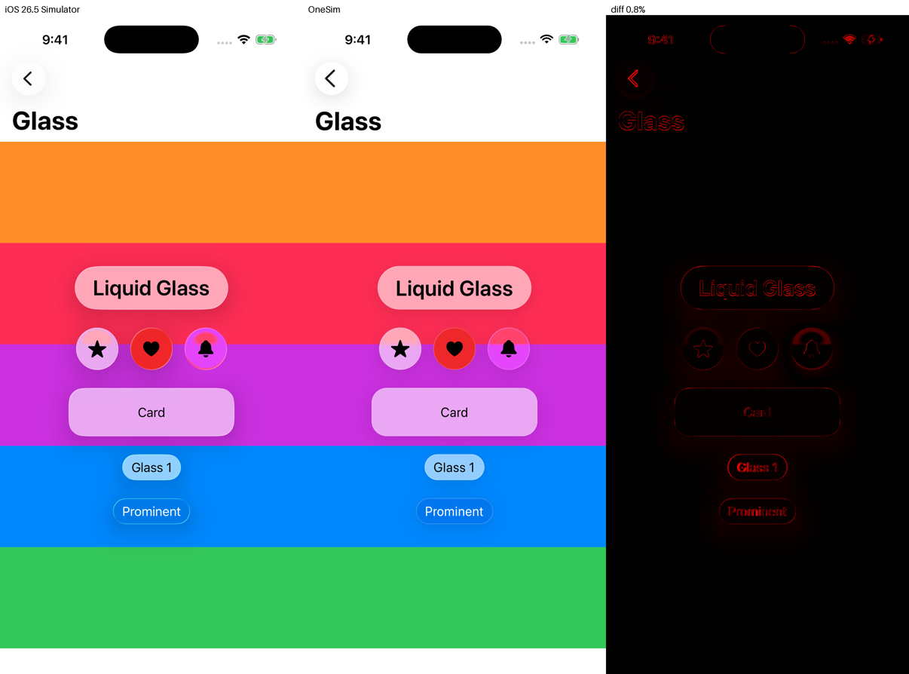
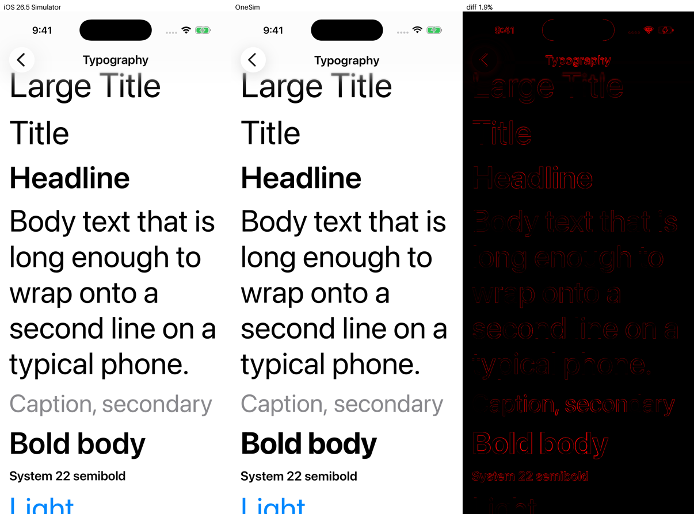
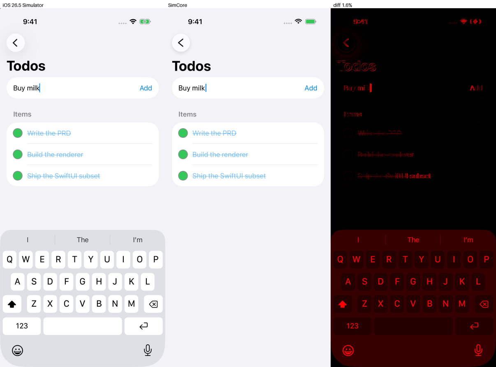
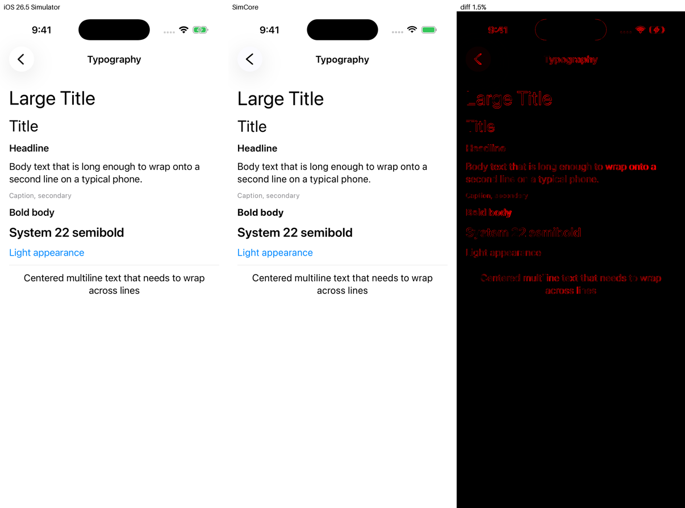
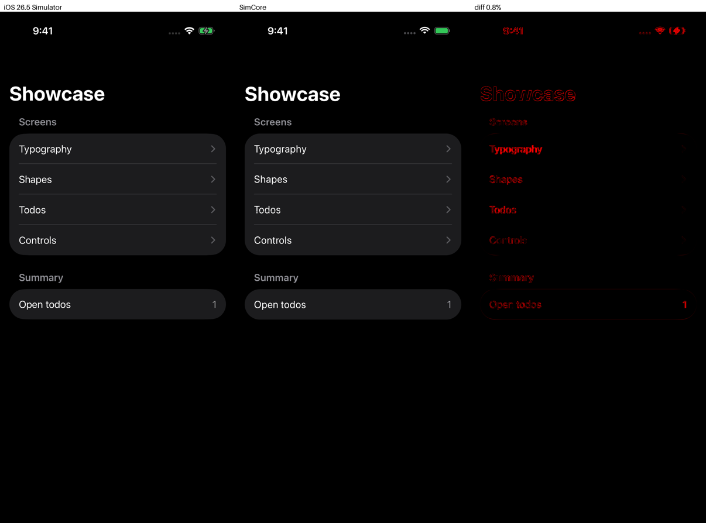

# SimCore vs iOS Simulator

Same unmodified source (`examples/swiftui-showcase/Showcase.swift`) rendered by:
- **iOS 26.5 Simulator**, iPhone 17 Pro (Apple's SwiftUI), shots in `tests/fixtures/showcase-ios/`
- **SimCore** (SimCore's SwiftUI module + Rust renderer, headless), 402×874 @3x

**Pass rule:** every state must be < 2% (see CONTRIBUTING.md). CI enforces it.

Reproduce: `scripts/compare-ios.sh` (needs Python + Pillow). Re-capture iOS references: `scripts/build-ios-sim.sh`, then follow `tests/fixtures/showcase-ios/README.md`.

| state | system fonts | fallback (`SIMCORE_FALLBACK=1`) | notes |
|---|---:|---:|---|
| controls | 0.55% | 0.83% | text antialiasing, status bar icons |
| controls-changed | 0.69% | 0.84% | text antialiasing, status bar icons |
| glass | 0.81% | 0.97% | rim lens crescents on the star/bell, text antialiasing |
| glass-dark | 0.76% | 0.90% | rim lens crescents, text antialiasing |
| glass-pressed | 0.82% | 0.95% | same as glass; only the label differs |
| home | 0.73% | 0.99% | text antialiasing, status bar icons |
| home-dark | 0.74% | 1.00% | text antialiasing, status bar icons |
| keyboard-dark | 1.51% | 2.38% | keyboard keys, text antialiasing |
| keyboard-shift | 1.34% | 2.20% | text antialiasing, status bar icons |
| shapes | 0.41% | 0.56% | text antialiasing, status bar icons |
| symbols | 0.79% | 1.49% | text antialiasing, status bar icons |
| symbols-dark | 0.85% | 1.55% | text antialiasing, status bar icons |
| todos | 0.57% | 1.15% | text antialiasing, status bar icons |
| todos-toggled | 0.56% | 1.13% | text antialiasing, status bar icons |
| todos-typed | 1.36% | 2.22% | text antialiasing, status bar icons |
| typography | 1.68% | 2.74% | glyph-width drift (no SF `opsz` axis) |
| typography-scrolled | 1.98% | 4.95% **FAIL (< 3.5%)** | AX5 Dynamic Type + scroll-edge veil; glyph subpixel edges |
| typography-scrolled-dark | 2.00% | 4.91% **FAIL (< 3.5%)** | AX5 Dynamic Type + scroll-edge veil; glyph subpixel edges |

System mode: every state < 2% (18/18). Fallback mode: < 3.5% except the two `typography-scrolled` states (see Known gaps). Web vs native (`scripts/compare-web.sh`, fallback fonts on both sides): 0.00% in all 18 states.

## Fixed by this comparison

- **Spacers in stacks are sized last.** Before, `HStack { Text; Spacer }` split the space evenly, so text wrapped at half width.
- **System colors now use the iOS 26 palette.** Red #FF383C, orange #FF8D28, blue #0088FF, purple #CB30E0. Dark variants are sent over the wire (`Color.dark`).
- **SF Symbols** are rasterized from the host's system SF Symbols through AppKit. They are sized like iOS, and Label rows use iOS geometry.
- **Software keyboard.** Light and dark; keys are tappable; shift and auto-capitalization work; content moves up above it. Before this, the keyboard screen's mean pixel difference was 8.3; now it is 1.6.
- **Dynamic Island** is part of the device profile.
- **Shadows are a true Gaussian blur.** iOS uses sigma ≈ `radius` (fitted to the simulator's falloff), not radius/2.

## Liquid Glass and Dynamic Type

- **Glass is a backdrop effect** (`crates/simcore-render/src/glass.rs`): snapshot -> Gaussian blur (3pt) -> rim lens -> color transform (light `0.43 * raw + 0.575 * 255`, dark `0.57 * raw + 18`, clear `raw + 24`) -> tint -> 1px rim + soft shadow. Parameters and the fit are in docs/protocol.md F. The back button uses it too (it replaced the flat circle + shadow).
- **Scroll-edge effect:** content scrolled under the bars is veiled toward the background (0.42 at the bar, decaying to 0 by 32pt below it); no blur. The scrolled fixtures are captured at Dynamic Type AX5, so SimCore renders them with `--dynamic-type accessibility5` and `--scroll 200,500,0,40` (offset 40pt, positive = later content).
- **Dynamic Type** resolves text styles from Apple's size table (docs/protocol.md F). The scrolled fixtures say "accessibility-extra-extra-extra-large": that is AX5 (large title 60pt, body 53pt), which the frames confirm.
- The keyboard panel is not glass in the fixtures, so it is unchanged.

## Known gaps

- Fallback mode fails `typography-scrolled` (4.9%, limit 3.5%): Inter's glyph shapes and word spacing differ from SF at 43-60pt (per-line positions already match within ~1pt after fitting size scale 0.93, tracking and baseline; no threshold was changed). Measured limits: re-fitting every Inter knob (scale, tracking at 43/53/60pt, weight, baseline, x offset) bottoms out at 4.85%. Drawing Inter glyphs at SF Pro's own shaped positions (kerning included) reaches 2.9%, but SF's kerning is essential (5.1% without it), so closing the gap means shipping SF-derived advance and kerning tables, which was declined for licensing reasons.
- Glass lensing is modelled only in a ~3pt rim band (star/bell crescents are approximate); `interactive` glass has no pressed look (the pressed fixture only differs by its label).
- Dynamic Type scales text styles only (not nav titles beyond the inline-title cap, list headers, symbols or control sizes).
- System-mode `typography-scrolled(-dark)` pass at 1.98% / 2.00%, close to the limit: sub-pixel glyph rows differ from CoreText's.
- Text widths can drift 1–2 px from iOS. The battery bolt is approximate.
- Corners are circular, not continuous.
- The keyboard's suggestions are static, and it has no 123 or emoji layers.
- Symbols are monochrome only.

## Fallback mode (non-macOS hosts)

When Apple's fonts and symbols are unavailable, or when forced with `SIMCORE_FALLBACK=1`, SimCore uses bundled open assets:
- **Inter 4.1** (SIL OFL 1.1). Letter spacing is fitted per size so widths and wrapping match SF.
- **Phosphor Icons 2.1.1** (MIT). 270 SF Symbol names are mapped onto Phosphor's regular, bold and fill styles, sized to SF's layout boxes. Unmapped names draw a placeholder and report `unsupported_symbol`.

Pass rule in this mode is **< 3.5%**: the 2% budget plus the measured glyph-shape gap. CI runs both modes. Worst states are typography (2.85%), keyboard-dark (2.75%), todos-typed (2.24%) and keyboard-shift (2.23%), all driven by Inter's glyph shapes. All 13 states pass.

