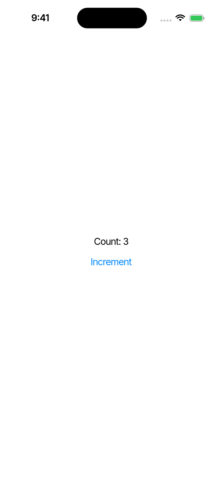

[OneSim](../README.md) / [Documentation](README.md)

# OneSim in the browser

Run SwiftUI or Jetpack Compose apps in a browser tab from a static file server alone — no native host process, no JVM, and no frame streaming.

- **SwiftUI**: the app, OneSim's SwiftUI module, and the Rust CPU renderer compile into one WebAssembly module (`app.wasm`).
- **Jetpack Compose**: the app, OneSim's Compose UI layer, and the real AndroidX Compose runtime compile to Kotlin/Wasm (`guest/guest.wasm` + `guest/guest.mjs`), connected over JS glue to the standalone `onesim-web` renderer (`app.wasm`).

Both paths share the same page, interaction state machine, and optional WebGPU presenter (`gpu/onesim_web_gpu*.{js,wasm}`). The preview responds to taps, drag and wheel scrolling, sliders, and text input from the on-screen or physical keyboard.

## Install the toolchain

Add both Rust Wasm targets and the version of `wasm-bindgen-cli` pinned by `onesim-web-gpu` (CI uses wasm-bindgen 0.2.130):

```sh
rustup target add wasm32-wasip1 wasm32-unknown-unknown
cargo install wasm-bindgen-cli --version 0.2.130 --locked
brew install binaryen    # optional: wasm-opt shrinks app.wasm ~25%; skipped (with a note) if absent or if it fails
```

- **For Jetpack Compose apps**: install Java 17+ (only needed at build time for `kotlinc-wasm`). `frameworks/compose/scripts/toolchain.sh --wasm` fetches the pinned Kotlin compiler and `wasmJs` klibs automatically without Gradle. No Swift toolchain is needed.
- **For SwiftUI apps**: also install a swift.org toolchain and its matching WebAssembly SDK (CI uses Swift 6.4.2):

```sh
curl -LO https://download.swift.org/swift-6.4.2-release/xcode/swift-6.4.2-RELEASE/swift-6.4.2-RELEASE-osx.pkg
installer -pkg swift-6.4.2-RELEASE-osx.pkg -target CurrentUserHomeDirectory   # -> ~/Library/Developer/Toolchains (or use swiftly)
PATH=~/Library/Developer/Toolchains/swift-6.4.2-RELEASE.xctoolchain/usr/bin:$PATH \
swift sdk install https://download.swift.org/swift-6.4.2-release/wasm-sdk/swift-6.4.2-RELEASE/swift-6.4.2-RELEASE_wasm.artifactbundle.tar.gz \
  --checksum 83baca83553f8c443cda7b84800912e6e709c3acd2e7ebf277794ca5836c0da5
```
Allow several GB of free space for the Swift toolchain. The build script finds the toolchain and SDK. Set `SIMCORE_SWIFT_TOOLCHAIN` to select a specific toolchain.

## Build and open the preview

From the repository root, build an app and serve the generated files. `scripts/build-web.sh` detects Jetpack Compose automatically when `<app_path>` is a `.kt` file or a directory with `.kt` sources.

```sh
# SwiftUI
scripts/build-web.sh examples/swiftui-counter CounterView
# or Jetpack Compose (Android Pixel 10a selected automatically)
scripts/build-web.sh examples/compose-showcase

python3 -m http.server 8000 -d target/web
```

Open [http://localhost:8000/](http://localhost:8000/). For SwiftUI `@main App` examples (such as `examples/swiftui-showcase`) or Compose `ComponentActivity` examples (`examples/compose-counter`, `examples/compose-showcase`, `examples/compose-input`), omit the root view argument. Pass a second argument to launch a specific SwiftUI `View` or Compose `@Composable` function.

<p align="center">
  
</p>

Serve the complete `target/web/` directory over HTTPS or localhost. Deploy `app.wasm`,
`gpu/onesim_web_gpu.js`, `gpu/onesim_web_gpu_bg.wasm`, `guest/` (for Compose builds), and the page files from the same build.

## Configure the viewport

| Query parameter | Effect |
| --- | --- |
| `?device=<name>` | Selects a profile. The default is `iphone-18-pro` for SwiftUI and `pixel-10a` for Compose. Find the available profiles in `window.onesim.sim.devices`. |
| `?width=402&height=874&scale=3` | Sets width and height in points and scale in pixels per point. By default, scale follows the window size and `devicePixelRatio`. |
| `?dark=1` | Selects dark mode. The default follows the browser’s color scheme. |
| `?renderer=cpu\|gpu\|auto` | `cpu` uses Canvas 2D. `gpu` and `auto` try WebGPU with Canvas 2D fallback. The query parameter takes precedence over `localStorage["simcore.renderer"]`. |
| `?diag` | Shows the active renderer and any fallback reason. |

The canvas preserves its aspect ratio and redraws when the window resizes.

## Use the page API

Call `window.onesim.setViewport(w, h)` or `window.onesim.setAppearance('dark'|'light')` to update the layout and Swift environment. To drive the app, call `click(label)`, `type(text)`, `key('backspace'|'enter')`, or `scroll(x,y,dx,dy)` on the same object. Read the UI tree with `inspect()` or `lastTreeText()`.

## GPU rendering

Two Wasm modules. `app.wasm` (wasm32-wasip1: Swift + layout + fonts + CPU raster) stays the runtime. With
`simcore_web_set_output(1)` its `draw` lowers the scene with a persistent `onesim_render::Builder` to an encoded
`DisplayList` (`simcore_web_dl_ptr/len`) instead of pixels (mode 0 produces CPU pixels).
Hit testing and interaction still come from the `Scene`. `gpu/onesim_web_gpu*.{js,wasm}`
(`crates/onesim-web-gpu`, wasm32-unknown-unknown + wasm-bindgen, built by `scripts/build-web.sh`) wraps
`onesim_render_gpu::Executor`: `await init(canvas)` -> `Gpu`; `gpu.render(bytes)` decodes, executes into an offscreen
`Rgba8Unorm` storage texture and blits it to the canvas (canvas textures cannot be storage textures; values are already
sRGB-encoded 8-bit, so the blit is a copy); `resize`, `info()` (JSON), `lost()`, `error()`, `free()`. The crate is
`#![cfg(target_arch = "wasm32")]` with wasm-only dependencies, so on native targets it is empty and
`cargo build/clippy --workspace` is unaffected; lint it with `cargo clippy -p onesim-web-gpu --target wasm32-unknown-unknown`.

`web/renderer.js` (`Presenter`) chooses the backend before the first frame: `renderer=cpu`, no `navigator.gpu`, a runtime
without display-list output, or any init failure -> CPU; otherwise GPU. After that, a render error, a lost device (polled
once a second, plus checked after every frame) or an uncaptured GPU error switches to CPU for good: `setOutput(0)`
(resets the builder), a fresh `<canvas>` (a canvas that got a `webgpu` context cannot give a `2d` one; input listeners are
on the `#stage` wrapper so they survive), and the same frame is shown with `putImageData`.
Rendering stays event-driven: a frame is presented only when input or the animation tick changed something.
`window.onesimRenderer` exposes `mode` (`gpu|cpu`), `reason`, `requested`, `info`, `frames`, `fallback()`.
Deploy `app.wasm`, the JavaScript and `gpu/` from the same build. Both Wasm modules use the internal display-list
version, and an incompatible pair triggers CPU fallback.

## How it works

- **ABI.** `onesim-web` exports the [`simcore_runtime_*` C ABI](protocol.md#c-c-abi-cratesonesim-runtime-header-simcore_runtimeh) in-process.
  `submit_tree` parses the ViewNode and renders it to an RGBA framebuffer. `run` returns at once.
- **Reactor.** Linked with `-mexec-model=reactor`. JS calls `_initialize`, then
  `simcore_web_init(w, h, scale, dark)`, which runs the Swift entry (`__main_argc_argv`: registers the app and
  *returns*; works for `_onesimRun(Root())` mains and `@main App`) and then pushes the environment, which
  makes Swift evaluate and submit the first tree. The instance stays alive; the browser is the event loop.
- **Interaction.** `onesim_render::Interaction` is the one state machine (scroll offsets, focus, shift,
  press target) shared with the native host. It maps a pointer/keyboard event + the scene to an `Effect`
  (`None | Action{id,version} | TextInput{field,version,text} | Redraw`). The host sends actions and text over
  the guest wire; `onesim-web` calls the Swift action/text callbacks directly and redraws. Label lookup
  (`resolve_label`, the CLI's `--click LABEL`) lives next to it.
- **JS exports** (small, scratch-buffer based for strings): `simcore_web_pointer(kind,x,y)` (0 down, 1 up,
  2 click; points), `simcore_web_scroll(x,y,dx,dy)`, `simcore_web_drag(phase,x,y,t_ms)` (0 begin at the
  touch-down point, 1 move, 2 end), `simcore_web_tick(dt_ms)` (advance momentum/bounce; 1 while moving),
  `simcore_web_key(kind,len)` (text / `backspace` / `enter`
  from the scratch buffer; only while a field is focused), `set_viewport`, `set_dark`, `set_ios` (0 = 26.5, 1 = 27.2),
  `set_dynamic_type` (index into the 12 Dynamic Type sizes), `set_scale`, `focused`,
  `inspect`, `find`, and `fb_ptr/len/width/height`. The browser page and Node harness share the `web/onesim.js` driver.
- **Input (main.js).** Pointer events map CSS px to points; moving more than 8 px turns a press into a
  touch drag (`Interaction::drag`: rubber band past the edges, then UIScrollView momentum and a critically
  damped bounce after lifting; a touch on moving content stops it). A `requestAnimationFrame` loop calls
  `tick` after any input until it returns 0. `wheel` scrolls directly (clamped, no physics: trackpads
  already coast) and deltaY > 0 reveals later content; `keydown` types printable keys, Backspace, Enter while a
  field is focused (tapping a field shows the on-canvas keyboard, whose keys also type).
- **Compose Wasm guest.** `onesim-web` built with `--features js-guest` (`cdylib`) imports `onesim_guest.{on_init, on_env, on_action, on_text}` and exports `simcore_web_submit_tree`. `scripts/build-web.sh` compiles the shared Compose UI layer (`frameworks/compose/src/`), `frameworks/compose/wasm/onesim/compose/WasmGuest.kt`, and a compile-time generated `OneSimWebEntry.kt` (replacing JVM `Class.forName`) with `kotlinc-wasm` and the Compose compiler plugin against the real `androidx.compose.runtime` `wasmJs` klibs. `WasmGuest` drives `Recomposer` synchronously with a FIFO `CoroutineDispatcher` and `BroadcastFrameClock`, so every tap, text edit, slider drag, and theme update recomposes and submits the updated `ViewNode` JSON to `onesim-web` within the same input turn. `web/onesim.js` detects the `onesim_guest` import automatically, loads `./guest/guest.mjs`, and selects `pixel-10a` (with its Android safe-area insets).
- **Fonts and symbols** use bundled Inter, Roboto (Android/Compose), and Phosphor. `scripts/compare-web.sh` compares SwiftUI browser CPU output with native `SIMCORE_FALLBACK=1` captures, and `scripts/compare-web-compose.sh` compares Compose browser CPU output with native Compose captures.
- **No Foundation on Wasm.** `Portable.swift` supplies `CGFloat`, `NSNull` and a small JSON writer
  under `#if os(WASI)`; native builds are unchanged.

## Testing

Use Node.js 22 or later for the test commands below. The presenter tests also need Chrome or Chromium. Run the
suite that matches the example you built.

```sh
node web/test/run.mjs --suite counter                 # or showcase, compose-counter, compose-showcase, compose-input
node web/test/run.mjs --click Todos --click "New todo" --type "Buy milk" --screenshot out.png --expect "Buy milk"
                                                      # CLI-style steps: --device NAME --click LABEL|X,Y --type --key --scroll X,Y,DX,DY --drag X,Y,DX,DY --dark --width/--height/--scale --inspect
node web/test/presenter.mjs                            # headless Chrome GPU and CPU fallback checks
node web/test/presenter.mjs --app                      # check the built SwiftUI showcase and state retained after device loss
node web/test/presenter.mjs --compose                  # check the built Compose app on CPU and WebGPU
scripts/compare-web.sh                                # compare each SwiftUI showcase state with native fallback, each < 2%
scripts/compare-web-compose.sh                        # compare each Compose state with native Compose, each < 2%
```
The `web` CI job installs Swift 6.4.2, its Wasm SDK, Java 17, and wasm-bindgen-cli 0.2.130. It builds both SwiftUI and Compose examples,
tests the Chrome presenter on both, and compares screenshots. CPU fallback is tested even when the runner has no WebGPU adapter.

## Gaps

Device profiles come from `DEVICES` (`crates/onesim-render/src/device.rs`, shared with the native host); other sizes via `?width=&height=`. The software keyboard has no
number/emoji layers (as native). No IME/composition input and no multi-touch. `wasm-opt` flags assume binaryen 133+.
